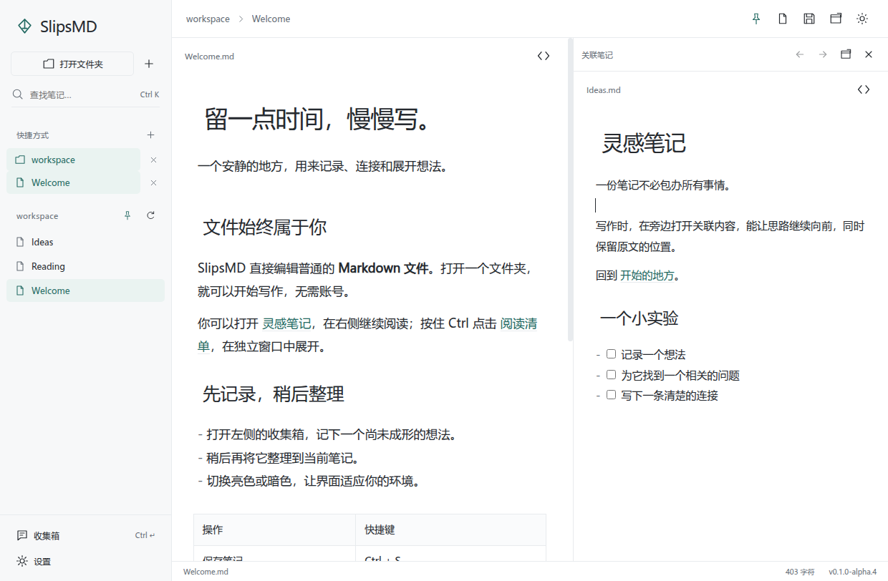

# slips.md

一个安静的开源 Markdown 桌面工作区。先记录，再整理；用链接展开想法，也可以把笔记放到独立窗口里。

**Electron + TypeScript + Vue 3 + CodeMirror 6** · MIT · Windows 优先

当前版本为 **0.1.0-alpha.2**。文件直接保存为普通 UTF-8 Markdown，不需要账号或同步服务器。

## 首版功能

- 打开单个文件或文件夹，浏览嵌套目录、新建笔记、按文件名筛选。
- CodeMirror 6 实时预览：标题、强调、链接、任务框、图片、KaTeX 公式、GFM 表格；随时切换源码模式。
- Ctrl+点击文件或内部链接，在独立窗口打开；同一文件已有编辑窗口时聚焦原窗口。
- 普通内部链接在右侧关联面板打开，支持返回、前进与关闭。
- 同工作区出链与反链列表；输入 `[` 补全笔记链接。反链不写入目标正文。
- Chat 收集箱：无需标题和分类，记录后保存到 Chat.md，之后整理到当前笔记。
- 粘贴图片保存到笔记旁的 assets 文件夹，或交给本机 PicGo 上传并插入 URL。
- 独立选择亮色、暗色或跟随系统，设置在窗口间同步并持久化。
- 自动保存、恢复草稿、外部变更检查和冲突时另存副本。未编辑的文件打开后不会重新序列化；保存保留 BOM 和主要换行格式。



## 下载和运行

Windows x64 安装包、zip 和 Linux tar.gz 见 [Releases](https://github.com/liuzhouquan/slips.md/releases/tag/v0.1.0-alpha.2)。也可在本地构建；没有经过代码签名的 alpha 包可能触发 Windows 的未知发布者提示。

开发环境需要 Node.js 24 与 npm。先安装依赖，再启动：

```sh
npm ci
npm run dev
```

若 Electron 运行时没有随依赖安装完成，可执行 `node node_modules/electron/install.js`。`ELECTRON_RUN_AS_NODE` 环境变量会让 Electron 以 Node 模式运行，开发时应清除此变量。Linux 需要可用的图形环境与 Electron 系统运行库。

```sh
npm run typecheck
npm test
npm run build
npm run test:desktop
npm run pack:win     # 推荐在 Windows 构建 NSIS 安装包和 zip
```

Linux 无显示器的测试环境使用 `xvfb-run -a npm run test:desktop`。测试使用临时工作区，不操作个人笔记。

体验附带笔记：在应用里打开 `examples/workspace` 文件夹。

## 使用方式

| 操作 | Windows / Linux |
| --- | --- |
| 打开文件 | Ctrl+O |
| 打开文件夹 | Ctrl+Shift+O |
| 新建笔记 | Ctrl+N |
| 新建独立窗口 | Ctrl+Shift+N |
| 保存 | Ctrl+S（同时有自动保存） |
| 加粗 / 斜体 | Ctrl+B / Ctrl+I |
| 编辑器查找 / 替换 | Ctrl+F / Ctrl+H |
| 筛选笔记文件名 | Ctrl+K |
| 收集箱 | Ctrl+Enter |
| 补全笔记链接 | 输入 `[`，选择结果后 Enter |

光标所在行保留 Markdown 标记，其余位置显示排版效果。点击图片、公式或表格的编辑按钮可回到源码。首版表格通过 Markdown 源码编辑，不提供完整电子表格式单元格编辑。

PicGo 设置：在 PicGo 中配置图床并启用本地服务，在 slips.md 设置中选择“通过 PicGo 自动上传”；默认地址为 `http://127.0.0.1:36677/upload`。slips.md 不接管图床密钥。上传失败时临时图片留在应用数据目录的 `pending-images` 下。

## 数据与边界

- 不开发整库同步；可用 Git、网盘、Syncthing 等工具处理文件。已打开文件出现外部变化时会刷新或提示冲突，不能把两份修改静默覆盖。
- 首次启动会从改名前的应用目录导入设置、恢复草稿和待处理图片，保留旧目录，并优先保留新版已有数据。升级前请退出旧应用。已有 Chat 标记继续兼容，新记录使用新的标记；无需批量修改个人笔记。
- Chat 内容和归档标记保存在普通 Markdown 中。整理会先追加到目标笔记，再将原记录标记为已整理；原始记录保留，便于恢复。
- 本地图片只在已授权文件目录／工作区内解析；首版支持 PNG、JPEG、GIF、WebP。
- 文件必须为 UTF-8；首版限制为单文件 20 MB、工作区 10,000 份 Markdown。大型工作区的扫描与索引尚待性能优化。
- 暂不包含：窗口内 tabs、外部目录收藏、多工作区双链、图谱、Telegram、远程 Web 编辑、Mermaid 渲染、PDF 导出、内部标题锚点跳转、文件重命名和删除 UI。
- macOS 未验证；Windows 与 Ubuntu 已通过 [CI](https://github.com/liuzhouquan/slips.md/actions/runs/45991725132) 的构建、源码启动及打包后桌面流程，具体结果见验证说明。真实 Windows 中文输入法组合输入、真实 PicGo 程序和不同第三方同步客户端仍需人工验收。

## 开发结构

```text
src/main/       窗口、文件服务、工作区、Chat、链接与 PicGo
src/preload/    隔离的类型化 IPC 桥
src/shared/     UI 与桌面之间的类型约定
src/renderer/   Vue 界面与 CodeMirror 6 预览扩展
scripts/        许可证生成与真实 Electron 桌面检查
test/           文件安全与链接解析测试
examples/       可公开使用的示例笔记
```

[命名与兼容](docs/branding.md) · [验证说明](docs/validation.md) · [产品需求](docs/product.md) · [技术分析](docs/technical-analysis.md) · [架构](docs/architecture.md) · [开发计划](docs/roadmap.md) · [决策记录](docs/decisions.md)

## 致谢与许可

产品设计参考 [Files.md](https://github.com/zakirullin/files.md) 的先记录后整理流程，以及 Typora 的桌面写作体验。当前没有复制 Files.md、MarkText 或 Muya 的实现代码。

slips.md 采用 [MIT](LICENSE)。CodeMirror、Vue、KaTeX 等依赖的许可全文见 [第三方声明](THIRD_PARTY_NOTICES.md)，由构建脚本根据锁定的生产依赖生成。Electron 自带其 Chromium / Node 第三方许可。
