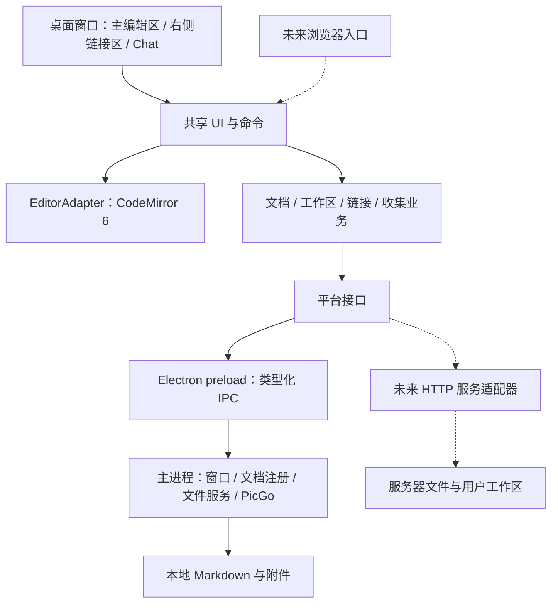

# 架构草案

状态：架构方向与首版实现对照。已确认 Electron + Vue 3 + CodeMirror 6。首版采用单 npm 工程、src/main、src/preload、src/shared、src/renderer 分层；下方 packages 布局为未来拆分建议。

实现差异：首版单文件重复打开聚焦原窗口；文件服务防止跨窗口直接写入；链接索引按需扫描工作区，尚未实现增量缓存；关联导航已有返回/前进，但尚不恢复每份笔记的历史滚动位置；尚无独立远程 Web 服务。

## 分层与未来入口

虚线部分是未来方向，首版不实现。preload 是 renderer 上下文的桥接代码，不是第三个独立 OS 进程。正式项目可按以下结构起步，不在当前阶段创建空实现：

- apps/desktop：Electron 主进程、preload、窗口与桌面生命周期。
- packages/ui：Vue 工作区、编辑区、关联面板、Chat 与设置。
- packages/core：文档身份、命令、链接解析、索引接口和收集流程。
- packages/editor：编辑器封装，隔离 CodeMirror 扩展和编辑状态。
- packages/platform：文件、窗口、上传器、设置的接口及桌面适配。
- apps/web、apps/server：未来需要远程入口时增加。

不要为了多端预留而写一套空插件系统；先以最少接口隔开窗口、文件与上传等明确的平台差异。

## 文档、窗口与工作区

WorkspaceId 标识被明确打开的目录；DocumentId 由存储端身份和规范路径确定。WindowId 是显示容器，PaneId 是窗口中的主编辑区或右侧面板，它们都不拥有文件最终写入权。单个文件可独立打开，不强制加入整个父目录索引。

桌面主进程维护已打开文档注册表、各视图的编辑权与每文档写入队列。Windows 路径归一化要兼顾盘符、UNC、大小写语义、符号链接与大小写敏感目录，不能只对字符串统一转小写。工作区外文件、同名文件不能仅靠 basename 识别。

建议第一版：同一文件已有编辑视图时，默认聚焦它；用户显式重复打开则给出只读镜像，允许在保存完待提交内容后转移编辑权。不同文件支持真正并行编辑。这样不必首版实现协作算法，仍能满足多窗口使用。此策略是建议，需要在交互原型确认。

多窗口共享的是文档变更通知和应用设置，各窗口的选区、滚动位置、阅读历史独立保存。第二个窗口关闭不影响第一个；窗口关闭前处理未保存修改与上传中的草稿，崩溃恢复按文档保留。

## 文件写入与第三方同步

所有来源统一调用文件服务：编辑器保存、Chat 追加、整理到文件、文件移动、外部事件导入都走相同队列。

保存请求带 baseRevision 和期望磁盘版本。服务串行化本应用对同一文档的操作，写前检查外部修改，利用平台适当的临时文件与替换策略，成功后广播新版本。已脏文档遇到外部变更时保留两份内容并提供冲突处理，不能直接重载或自动覆盖。

文件监听事件要去重并识别自身写入；监听可能漏报，窗口重新聚焦和保存前还应重新核对。版本号、摘要与原子替换降低风险，但不能承诺阻止所有不合作的外部进程竞态。Windows 文件锁、杀毒软件、网盘和网络盘需实测。

未编辑文件打开后关闭，不应被解析器重新输出。实际编辑后如需序列化，要验证 CRLF、BOM、YAML、空行、链接转义、HTML 和未知扩展；有损能力必须显式界定，必要时保留源码编辑。索引、草稿和 UI 状态置于应用数据目录，不用数据库取代 .md 正文。

Chat 的“移动到已有文件”涉及两次写入，不能当作普通原子 rename。建议记录可恢复操作：先完成目标追加，确认持久化后再标记或移除源条目；用操作身份防止重启后重复归档。失败时原始想法仍能找回。

## 链接与右侧内容

LinkResolver 解析当前文件相对路径、工作区根路径、URL 编码和标题锚点。代码块、行内代码和普通图片不当作笔记引用。增量索引建立出链和反链，索引可从磁盘重建；未保存编辑可先形成内存覆盖层。

A 链接到 B 后，B 的反链列表展示 A 和引用上下文，不自动修改 B 的正文。支持移动或重命名后的索引刷新与断链提示；自动批量改写所有引用文件先不作为默认行为。导入 Files.md 时兼容其 /path.md 工作区根链接，并识别既有正文反向链接而不重复生成。

主区 A 点击内部链接打开右侧 B；在 B 继续导航到 C，保留 B 的历史。返回时恢复 B 的位置，主区 A 不切换。Ctrl+点击走 WindowService 新建窗口。首版一个右侧面板可编辑不同文档，任意深度并排堆叠可后续加入；同路径面板遵守统一编辑权策略。

跨工作区固定目录只提供导航快捷入口，不默认跨库索引。未来可增加文档 URI 和库身份映射，但首版不输出绑定某台机器绝对路径的跨库双链协议。

## Chat、图片与主题

Chat 以 Markdown 文件落地，建议每工作区 Chat.md，用户无需先取标题。对已在编辑器中打开的 Chat.md 追加内容必须通过文档会话，防止磁盘已追加而旧编辑器保存回滚。首次快记无需繁琐设置；整理范围和默认收集箱归属在 UI 原型确认。

ImageUploader 接口接收本次图片字节／临时文件和上传操作 ID。PicGoGuiUploader 由主进程访问本机配置地址，传本次图片的具体路径；只接受合法图片 URL 结果，不把用户图床密钥复制进 Inkisle。可先插入可恢复占位；上传完成定位原文档的原操作，用户已撤销或删除占位时不再插回。失败支持重试或选择本地保存，离线与重启不丢原图片，成功后清理临时数据。

主题状态为 light / dark / system，应用设置持久化并广播至各窗口，解析后的主题同时作用于应用 UI、编辑器、代码和图表。显式选 light / dark 时不被系统变化覆盖。未来自定义 CSS 与主题市场另行设计。

## 未来 Web 与远程收集

浏览器版可以共用编辑器、工作区 UI 和大部分纯业务代码，但不能直接使用 Electron 文件与窗口 API。登录后的服务端在被授权目录里读写文件，通过带版本的接口保存；还需会话、目录隔离、路径越界防护、外部修改处理和连接中断策略。它是远程访问同一存储服务，不等同于做本地副本同步；没有必要现在引入 CRDT。

桌面 PicGo 的本机路径对远程服务器无意义；HTTPS 页面直连 localhost 还涉及浏览器网络权限、CORS 和策略变化。Web 版需要服务端上传适配或明确安装本地桥，不能把桌面 PicGo 集成原样承诺给浏览器版。

Telegram 若后续实施，优先定义远程接收器 → 持久事件箱 → 客户端补拉 → Chat 追加的单向收集流程，处理去重、确认和失败恢复。Bot token 留在接收器或受保护的本地凭据中，界面不记录明文凭据；不把 Bot 当作完整文件同步协议。

## 桌面边界

Markdown 可能来自任何文件。Electron renderer 采用隔离与沙箱，Node 文件能力仅通过受限 preload 暴露；链接协议和图片 URL 要验证，正文 HTML 不得执行脚本，本地媒体通过受控资源映射提供。新窗口只能通过应用命令创建本地应用页面，外部 HTTP 链接在系统浏览器打开。[Electron 官方安全指南](https://www.electronjs.org/docs/latest/tutorial/security)
